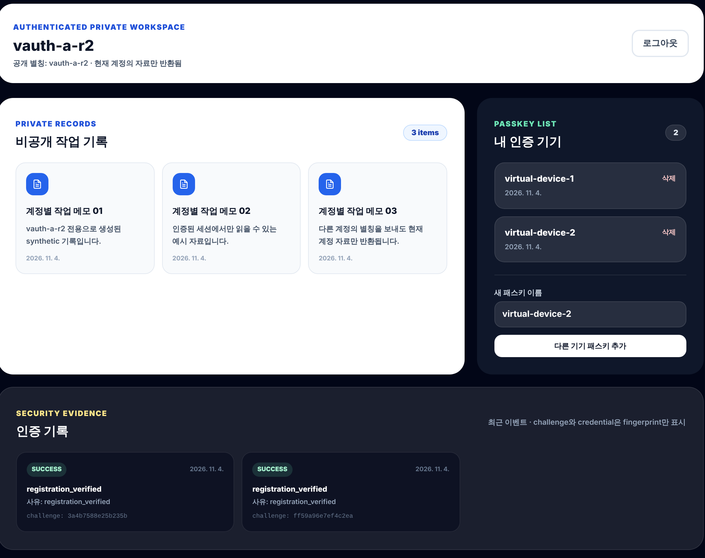

  <h1>🔐 Passkey Private Portfolio</h1>
  
<strong>공개 포트폴리오와 나만의 private workspace를 하나의 서비스 경험으로.</strong>

  
비밀번호 없이 passkey로 인증하고, 인증된 계정의 자료만 안전하게 보여주는 포트폴리오 서비스입니다.

  

    <a href="https://aleph-first-homework.vercel.app">배포 사이트</a>
    ·
    <a href="docs/T08_SETUP.md">설정 가이드</a>
    ·
    <a href="docs/T08_EVIDENCE_TEMPLATE.md">검증 기록</a>
  

  

    
    
    
    
  

  
  
인증 후 private workspace (가상 authenticator로 시험한 배포 화면, 가상 데이터)

---

| | |
| --- | --- |
| 구성 | 개인 프로젝트 · ALEPH 과제 |
| 기간 | 2026.09.09 – 2026.09.10 (검증 기록은 2026.11.04 추가) |
| 참고 | 공개 화면의 이름·연락처(`JHJ`, `hello@example.com`)와 private 자료는 모두 **가상(synthetic) 데이터**입니다. |

## 서비스 흐름

~~~mermaid
flowchart LR
    A["Public portfolio"] --> B["WebAuthn passkey"]
    B --> C["Vercel API"]
    C --> D["Supabase PostgreSQL"]
    D --> E["Private workspace"]
~~~

## 핵심 기능

- **Passwordless access** — 비밀번호를 저장하거나 입력하지 않고 기기·보안 키의 passkey를 사용합니다.
- **Account isolation** — 현재 로그인 세션의 account_id로만 private 자료를 조회합니다.
- **Multi-device** — 한 계정에 여러 passkey를 등록하고 개별 삭제할 수 있습니다.
- **Security evidence** — 성공·실패·replay·인가 거부를 짧은 fingerprint와 reason code로 기록합니다.

## 보안 설계

| 원칙 | 구현 |
| --- | --- |
| private key 보호 | private key는 기기 또는 authenticator에 남고 서버에는 public key만 저장 |
| challenge 재사용 방지 | challenge를 만료 시간과 함께 저장하고 검증 전에 원자적으로 소비 |
| session token 보호 | cookie에는 opaque token, DB에는 SHA-256 digest만 저장 |
| 계정 범위 강제 | private query와 다른 계정 URL 모두 session.account_id 기준으로 검사 |
| 직접 DB 노출 차단 | 브라우저는 DB에 연결하지 않고 Vercel API만 호출 |
| DB 방어 계층 | 6개 서버 전용 테이블(`t08_*`) RLS 활성화 및 PUBLIC 직접 테이블 권한 철회 |

## 기술 스택

- **Frontend**: 단일 `index.html` portfolio + native Web Authentication API
- **API**: Vercel Node.js Functions
- **Authentication**: WebAuthn, @simplewebauthn/server
- **Database**: Supabase managed PostgreSQL, @supabase/supabase-js (server-only)
- **Validation**: Node.js syntax check, 정적 검사(`npm run check`), npm audit

## 검증 현황

배포 사이트에 Chromium의 WebAuthn **가상 authenticator**로 실행한 결과입니다. 서버는 실제 서명·origin·RP ID·challenge를 검증했지만 물리 기기로 한 시험은 아닙니다. 자세한 응답과 캡처는 [검증 기록](docs/T08_EVIDENCE_TEMPLATE.md)과 [`evidence.json`](docs/evidence/evidence.json)에 있습니다.

| 검사 | 기대 결과 | 가상 authenticator | 실기기 |
| --- | --- | --- | --- |
| 로그인 없는 private read | 401 authentication_required | 확인 (401) | 미확인 |
| 정상 passkey 로그인 | 200 및 private workspace 표시 | 확인 (200) | 미확인 |
| 계정 A/B 자료 분리 | 서로 다른 synthetic records | 확인 | 미확인 |
| 다른 accountId 접근 | 403 account_scope_mismatch | 확인 (403, 양방향) | 미확인 |
| challenge replay | 401 challenge_rejected | 확인 (401) | 미확인 |
| passkey 삭제 | 목록 감소 및 삭제 credential 거부 | 확인 (2→1, 삭제 credential 401) | 미확인 |
| security events | fingerprint와 reason code만 반환 | 확인 | 미확인 |

정적 검사(`npm run check`)는 코드와 문서에 특정 문자열이 있는지 확인할 뿐 동작을 증명하지 않습니다. 동작 증거는 위 표의 기록을 따릅니다.

## 시작하기

~~~bash
git clone https://github.com/coding-jhj/aleph-first-homework.git
cd aleph-first-homework
npm ci
npm run check
~~~

실제로 동작시키려면 Supabase 프로젝트와 Vercel 환경변수가 필요합니다. 순서는 [설정 가이드](docs/T08_SETUP.md)를 따릅니다.

## 저장소 구조

~~~text
.
├── index.html        # 공개 포트폴리오 + private 영역 UI
├── api/              # Vercel Functions (passkeys, private, security, session)
├── db/migrations/    # PostgreSQL schema와 RLS
├── docs/             # 설정·구현·검증 문서와 캡처
└── scripts/          # 문법·정적 검사
~~~

## 제한 사항

- 실기기(Windows Hello·휴대전화 passkey·FIDO2 보안 키)로는 아직 시험하지 않았습니다.
- 실제 passkey 검증은 HTTPS와 실제 authenticator가 필요하고, Supabase migration 실행에는 배포 계정 권한이 필요합니다.
- Preview Protection이 켜져 있으면 Preview API 대신 접근 가능한 Production 또는 테스트 배포를 사용해야 합니다.
- 마지막 passkey를 삭제하면 해당 계정의 세션도 종료됩니다.
- 복구 이메일이나 관리자 강제 재등록 기능은 범위에 포함하지 않았습니다.
